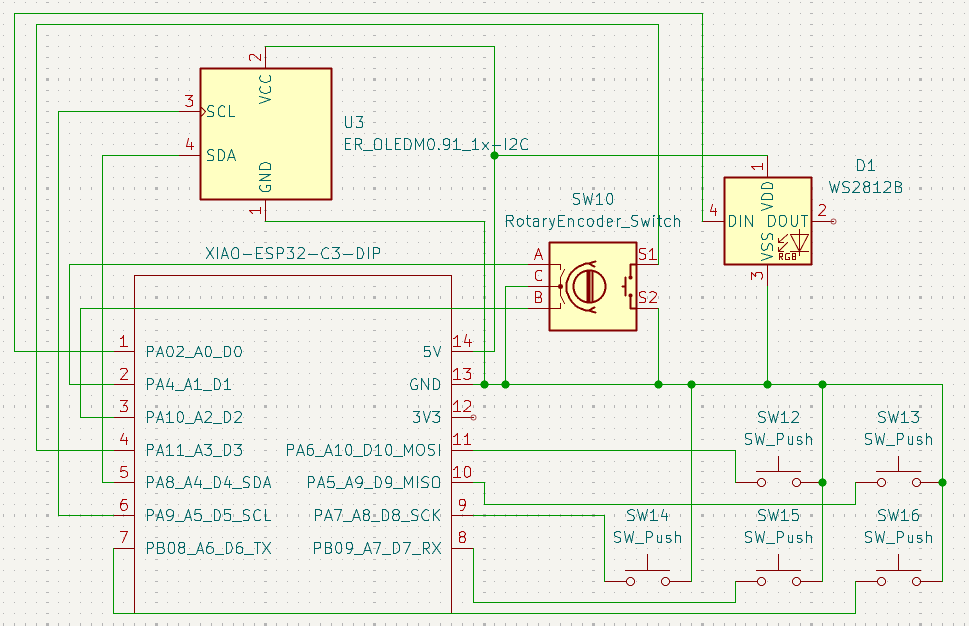
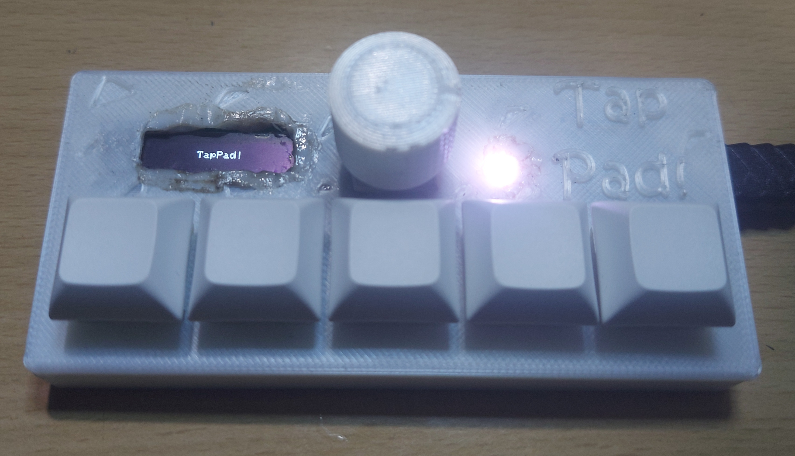

# TapPad
TapPad speeds up annoying tasks. You can use the keys to assign custom macros on your device or use the rotary switch to control media. It has a customizable 0.91 inch OLED status display and a LED indicator.

# PCB Design 
The PCB was made on Kicad. It connects all 5 switches, rotory encoder switch, LED and the OLED display, to the Seeduino board. 
Schematic and PCB layout is as follows - 

# Case design 
Case designed on fusion for the pcb having 5 switches, one rotary encoder, an OLED display and the LED indicator with a USB-C port on the right side. It assembles via 4 magnets flushed inside the corners of the base and lid. 
It has grooves and extruded covers to fit the OLED display, rotary encoder and seeeduino USB-C. 
Triangular designs have been engraved along with a extruding "Tap Pad!" text to give it a unique design.  

# Firmware
 - The firmware is made via QMK. It assigns the function keys from F13 to F20 to the 5 switches and rotary. 
 - [OLED Display Control](https://github.com/Yash-Takhtani/TapPad/blob/main/tappad.py) can be used to control the rgb led.
 - The actions on button presses can be configured through [TapPad keymap](https://github.com/Yash-Takhtani/TapPad/blob/main/TapPad keymap.py). In this example I control my Smart LED bulb, the rgb led on the board, my pc wallpaper and open some apps/websites with the keypresses.
 - The buttons have been mapped to function keys as follows - 
   - Key1 - F13
   - Key2 - F14
   - Key3 - F15
   - Key4 - F16
   - Key5 - F17
   - Roatary- - F18
   - Roatary+ - F19
   - Roatary Button - F20
**NOTE -** The python files require variable dependencies like the bulb api might bight be different for your bulb and the actions you want the buttons to make might be of your choice. In that case its recomended you edit 'TapPad keymap.py' file according to your needs and run it with python. Also the 'led.py' only allows you to control the RGB LED on the board with python.  

# Bill of Materials
Hackpad kit -
- 1x unsoldered Seeed XIAO RP2040
- 5x MX style switches
- 1x EC11 Rotary encoder
- 1x 0.91 inch OLED display
- 5x white blank DSA keycaps
- 1x SK6812 MINI-E LEDs

To be purchased with the grant - 
- PCB (from external PCB manufacturer like JLCPCB)
- 3D printed case and rotary cap from Printing Legion

# Build
**I completed the build!**

During the build I slightly misplaced the oled display due to which i had to modify the display cutout with my coldering iron. It kinda left burnt marks. I have added extra clearances to the CAD.

# Next Steps
Configurable OLED python script